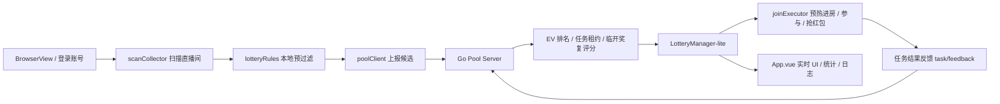

# 抖音福袋助手

基于 `Electron + Vue 3 + Naive UI` 的桌面端多账号抖音福袋工具，支持本地扫码登录、自动扫描福袋、分布式候选池、服务端统一筛选与调度、自动参与、红包尝试、随机互动、统计展示，以及 Go 高并发筛选服务。

当前版本：`v1.2.0`

## 免责声明

本项目仅用于学习、研究 Electron 自动化、任务调度、候选池筛选与界面实现。  
请自行评估并承担账号风控、平台限制、协议合规、业务后果和部署安全责任。

---

## 1. 项目定位

这个项目解决的是一件事：

`在本地保存账号登录态的前提下，尽量多地扫描全网福袋，并把更值得参与的候选优先分配给空闲账号。`

它不是一个“纯脚本接口调用器”，而是一个完整桌面客户端，包含：

- 多账号登录与隔离会话
- Electron 主进程 BrowserView 管理
- 前端配置面板与实时日志
- 扫描候选池
- 服务端 EV 排名与任务租约
- 预热进房 -> 复检 -> 参与 的执行链路
- 红包尝试与随机互动
- 本地统计与历史记录
- Go 服务端 + Redis 共享池 + 离线学习回放

---

## 2. 当前代码实际入口

很多人看项目时会先找“真正的入口”和“当前生效的是哪套逻辑”。这里直接说明。

### 2.1 客户端入口

| 模块 | 作用 | 说明 |
| --- | --- | --- |
| `electron/main-browserview.js` | Electron 主进程入口 | 当前桌面客户端主入口，负责窗口、BrowserView、登录、会话、IPC |
| `electron/preload.js` | 渲染进程桥接 | 暴露 `window.electronAPI` |
| `src/renderer-entry.js` | 前端渲染入口 | 挂载 Vue 应用 |
| `src/App.vue` | 前端主页面 | 负责配置、账号列表、统计、日志、面板展示 |
| `src/services/LotteryManager-lite.js` | 当前实际调度核心 | 当前生效的扫描、预热、参与、服务端交互核心控制器 |

### 2.2 当前不是主入口的文件

| 文件 | 状态 |
| --- | --- |
| `src/services/LotteryManager.js` | 历史/旧版逻辑，当前 `App.vue` 没有引用 |
| `超人福袋助手/` | 参考资料目录，不参与当前运行 |

`App.vue` 当前引用的是：

```js
import LotteryManager from './services/LotteryManager-lite'
```

这意味着你调试主流程时，优先看：

- `src/services/LotteryManager-lite.js`
- `src/services/scanCollector.js`
- `src/services/joinExecutor.js`
- `src/services/poolClient.js`
- `src/utils/lotteryRules.js`
- `electron/main-browserview.js`

---

## 3. 核心能力清单

当前代码已经覆盖的能力如下。

### 3.1 客户端能力

- 多账号扫码登录，账号间独立 session / cookie / BrowserView
- 登录成功后自动读取账号昵称
- 本地 token 持久化存储，支持自动登录
- 全站扫描 + 分类深分页扫描
- 会员房/粉丝团/实物/大红包等过滤
- 预热进房停留，不再只在最后几秒裸进房
- 临开奖 `T-30 / T-20` 复评分
- 抢后停留、等待开奖补扫、随机互动
- 自动抢红包
- 运行日志、学习面板、账号统计、候选面板、历史记录

### 3.2 服务端能力

- 候选批量上报
- 候选去重：`roomId + lotteryId`
- TTL 自动过期
- EV 排名
- 任务租约：`claim / renew / release / finish`
- 服务端临开奖复评分：`review`
- 分布式扫描分片分配
- 全站 `maxTime` 共享游标推进
- 集群级 permit 硬限流
- 反馈回流
- 学习桶调试
- 离线回放与权重回归

### 3.3 数据与部署能力

- Go 服务端本地运行
- Docker 本地构建镜像
- Docker Compose 本地/服务器部署
- Redis 共享池模式
- 反馈日志 JSONL 落盘
- 离线 replay 训练

---

## 4. 核心架构

### 4.1 三层角色一定要分清

当前代码把运行角色拆成 3 层：

| 层级 | 含义 | 例子 |
| --- | --- | --- |
| 客户端 `client` | 一个运行中的桌面程序实例 | 一台机器上启动的一个 Electron 应用 |
| 账号 `account` | 一个抖音登录态 | 一个扫码登录后的本地账号 |
| 服务端 `pool server` | 候选池与调度中心 | Go 服务 + Redis |

关键原则：

- `客户端` 负责本地界面、会话、扫码登录、BrowserView 控制
- `账号` 负责真正进房、预热、参与、等待开奖
- `服务端` 不保存 token，只做候选池、分配、复评分、学习

### 4.2 数据流



### 4.3 当前执行链路

1. 客户端登录账号并建立独立 BrowserView
2. 空闲账号承担扫描职责
3. 扫描结果先做本地硬过滤
4. 候选上报到服务端共享池
5. 空闲账号从服务端 `claim` 一个候选
6. 账号进入直播间，开始预热
7. 到 `T-30 / T-20` 走服务端 `review`
8. 保留当前房间、同房更新或跨房切换
9. 执行参与
10. 结果回传服务端用于学习

---

## 5. 目录结构

```text
dy_fudai/
├── electron/
│   ├── main-browserview.js        # Electron 主进程入口
│   ├── douyinLiveRemote.js        # 主进程远端接口调用与数据整理
│   ├── preload.js                 # 渲染进程桥接
│   └── logger.js                  # 主进程日志工具
├── src/
│   ├── App.vue                    # 主界面
│   ├── renderer-entry.js          # Vue 渲染入口
│   ├── components/
│   │   ├── ConfigPanel.vue        # 左侧配置
│   │   ├── HeaderStats.vue        # 顶部监控中心
│   │   ├── AccountList.vue        # 账号列表
│   │   ├── LotteryDetail.vue      # 福袋面板
│   │   └── LogPanel.vue           # 运行日志/学习面板
│   ├── services/
│   │   ├── LotteryManager-lite.js # 当前主调度器
│   │   ├── LotteryManager.js      # 旧版逻辑（当前未使用）
│   │   ├── scanCollector.js       # 扫描与候选整理
│   │   ├── joinExecutor.js        # 预热/参与/红包执行
│   │   ├── poolClient.js          # 与 Go 服务端通信
│   │   └── scanRiskPolicy.js      # 扫描风控节奏控制
│   └── utils/
│       ├── lotteryRules.js        # 本地过滤与奖品规则
│       └── logger.js              # 前端日志工具
├── pool-server-go/
│   ├── cmd/poolserver/main.go     # Go 服务入口
│   ├── cmd/learning-replay/main.go# 离线回放入口
│   ├── internal/pool/             # 候选池/任务/学习/扫描/Redis 实现
│   ├── Dockerfile
│   ├── docker-compose.yml
│   ├── docker-compose.redis.yml
│   ├── config.example.json
│   └── README.md
├── scripts/
│   ├── build-pool-image.sh        # 构建 Go 服务镜像
│   ├── deploy-pool-local.sh       # 本地/服务器 docker compose 部署
│   └── pool-dump.mjs              # 导出服务端候选池
├── tokens.example.json
├── package.json
└── README.md
```

---

## 6. 环境要求

### 6.1 客户端

- Node.js `>= 18.18.0`
- npm `>= 8`
- 推荐使用 Node `18 LTS` 或 `20 LTS`
- Windows / macOS 均可

### 6.2 服务端

可选安装：

- Go `1.22+`
- Docker `24+`
- Docker Compose 插件
- Redis `7+`（推荐，多客户端共享池时建议启用）

### 6.3 推荐组合

| 场景 | 推荐 |
| --- | --- |
| 单机开发 | Node + npm，服务端可不开 |
| 多客户端联动 | Node + Go 服务 + Redis |
| 服务器部署 | Docker + Redis |

---

## 7. 快速开始

### 7.1 安装依赖

```bash
npm install
```

### 7.2 启动前端桌面客户端

```bash
npm run electron:dev
```

### 7.3 基本使用流程

1. 点击“添加账号”
2. 在弹出的登录窗口扫码登录
3. 登录成功后，账号昵称会出现在账号列表
4. 点击账号右侧“启动”
5. 系统开始扫描、预热、复检、参与
6. 在“运行日志”“学习”“福袋面板”查看实时信息

### 7.4 首次建议

- 先只登录 `1~2` 个账号验证链路
- 先确认“过滤粉丝团 / 只抢实物 / 优先大红包”等配置符合预期
- 如果启用服务端，先确认 `/health` 和 `/stats` 正常

---

## 8. 常用命令

### 8.1 客户端命令

| 命令 | 说明 |
| --- | --- |
| `npm run electron:dev` | Electron 开发模式 |
| `npm run build` | 仅构建前端静态资源 |
| `npm run electron:build` | 构建桌面安装包 |
| `npm run electron:build:win` | 构建 Windows 安装包 |
| `npm run electron:build:mac` | 构建 macOS 包 |

### 8.2 服务端命令

| 命令 | 说明 |
| --- | --- |
| `npm run pool:server:go` | 启动 Go 筛选服务 |
| `npm run pool:docker:build` | 构建 Go 服务 Docker 镜像 |
| `npm run pool:docker:up` | 本地一键部署服务容器 |
| `npm run pool:dump` | 打印当前服务端候选池 |
| `npm run pool:learning:replay -- --input <jsonl>` | 使用反馈日志做离线回放 |

### 8.3 调试命令

启用扫描追踪日志：

```bash
DY_SCAN_TRACE=1 npm run electron:dev
```

打印服务端候选池：

```bash
POOL_SERVER_URL=http://127.0.0.1:9090 npm run pool:dump
```

---

## 9. 客户端默认行为与配置项

当前代码里，默认值并不是完全靠 README 假设，而是直接来自 `src/App.vue` 与 `src/components/ConfigPanel.vue`。

### 9.1 界面可配置项

| 配置项 | 默认值 | 作用 |
| --- | --- | --- |
| 参与上限 | 关闭，值 `80` | 单账号每日最大参与次数 |
| 过滤粉丝团 | 开启 | 跳过需要加入粉丝团的福袋 |
| 只抢实物 | 关闭 | 仅保留实物奖品福袋 |
| 优先大红包 | 开启，阈值 `40` | 优先保留人均红包金额较高的红包 |
| 启用筛选服务 | 开启 | 使用远端 Go 服务统一筛选/调度 |
| 筛选服务地址 | 默认解析为 `http://110.40.169.26:9090` | 可被本地持久化地址覆盖 |
| 运行时长 | 关闭，值 `3小时` | 单账号运行时长限制 |
| 抢后停留 | `5秒` | 参与结束后的停留时间 |
| 人数过滤 | 关闭，值 `1000` | 过滤在线人数过高的房间 |
| 自动抢红包 | 开启 | 在直播间自动尝试红包 |
| 随机互动 | 开启 | 等待开奖时随机点赞/弹幕 |

### 9.2 当前代码中仍保留但界面未展示的内部策略

这些值不是给普通用户在界面里频繁改的，而是当前代码内置策略。

| 策略 | 当前值 | 说明 |
| --- | --- | --- |
| `minProbability` | `0.01` | 内部最小概率阈值 |
| `hitRate.enabled/value` | `true / 0.1` | 参与命中率相关内部阈值 |
| `secondInspect.enabled/value` | `true / 0.05` | 二次复检相关内部阈值 |
| `PREHEAT_SELECT_MAX_SEC` | `150` | 默认只优先领取剩余时间不太长的候选 |
| `PREHEAT_REVIEW_WINDOWS_SEC` | `[30, 20]` | 服务端临开奖复评分时间窗 |
| `PREHEAT_MAX_CROSS_ROOM_SWITCHES` | `1` | 单轮最多跨房切换次数 |

### 9.3 默认行为总结

- 参与上限默认关闭
- 运行时长默认关闭
- 优先大红包默认开启
- 粉丝团过滤默认开启
- 自动抢红包默认开启
- 随机互动默认开启
- 默认启用服务端筛选

---

## 10. 账号、客户端、服务端如何分工

这是当前代码最容易理解错的一部分。

### 10.1 定义

- `客户端 client`：一个运行中的桌面程序实例
- `账号 account`：一个本地登录的抖音账号
- `服务端 pool server`：共享候选池和调度中心

### 10.2 当前分工

| 层级 | 负责内容 | 不负责内容 |
| --- | --- | --- |
| 客户端 | UI、账号管理、BrowserView、会话、扫描调度 | 保存服务端共享 token |
| 账号 | 进房、预热、参与、等待开奖、抢红包 | 全局任务分配 |
| 服务端 | 候选池、评分、租约、学习、扫描 permit | 真实登录执行 |

### 10.3 当前调度原则

- 所有账号的主目标都是参与福袋
- 只有空闲账号才会承担扫描职责
- 一旦账号进入 `claim / 预热 / 参与 / 等开奖 / 停留`，就退出常规扫描位
- 当候选池过少时，系统会强制保留扫描名额补池，避免“全部账号都去预热导致池子抽空”

---

## 11. 客户端工作流

### 11.1 扫描阶段

当前扫描由以下模块协作完成：

- `scanCollector.js`
- `scanRiskPolicy.js`
- `lotteryRules.js`
- `LotteryManager-lite.js`

行为包括：

- 全站首轮快扫
- 分类深分页扫描
- 多账号并发扫描
- 本地短期房间去重
- 服务端 permit 限流
- 服务端共享 `maxTime` cursor 推进

### 11.2 过滤阶段

本地会做第一层硬过滤，包括但不限于：

- 会员房/会员参与条件过滤
- 粉丝团福袋过滤
- 实物福袋过滤
- 红包大包优先
- 在线人数过滤
- 屏蔽房间过滤

### 11.3 服务端候选池阶段

客户端会把候选上报到服务端：

- `/candidate/batch-upsert`

服务端会：

- 去重
- TTL 过期
- 统一排序
- 输出池顶候选

### 11.4 参与阶段

当前不是“最后几秒才进房”，而是：

1. `claim` 任务
2. 进入直播间预热
3. 等待到 `T-30 / T-20`
4. 调用服务端 `review`
5. 保留当前房间或切换更优目标
6. 正式参与

### 11.5 参与后的反馈

会把结果回流服务端：

- `join_success`
- `join_failed`
- `draw_won`
- `draw_lost`

然后进入学习桶与离线回放体系。

---

## 12. 本地数据与持久化

### 12.1 token 存储

客户端会在本地保存 token。

开发环境：

- `tokens.json` 位于项目根目录

打包后：

- `tokens.json` 位于可执行文件所在目录

当前逻辑：

- 优先使用 Electron `safeStorage` 加密
- 如果系统不支持，则降级为明文 JSON

### 12.2 已被 `.gitignore` 排除的重要文件

以下文件不会提交到 Git：

- `tokens.json`
- `pool-server-go/config.json`
- `dist/`
- `dist-electron/`
- 日志与临时文件

### 12.3 本地浏览器与服务端相关状态

| 数据 | 保存位置 |
| --- | --- |
| 筛选服务地址 | 浏览器 `localStorage` 中的 `DY_POOL_SERVER_URL` |
| 当前客户端 ID | 浏览器 `localStorage` 中的 `DY_POOL_CLIENT_ID` |
| 账号 token | `tokens.json` |

---

## 13. Go 服务端

### 13.1 服务端做什么

Go 服务端只做筛选与调度，不做账号登录执行。

包括：

- 接收候选
- 维护共享池
- EV 排名
- 任务领取/续租/释放/完成
- 临开奖复评分
- 分布式扫描分片
- permit 硬限流
- 反馈学习

### 13.2 服务端不做什么

- 不保存抖音 token
- 不执行扫码登录
- 不直接进房参与
- 不替代客户端 BrowserView

### 13.3 本地运行

```bash
npm run pool:server:go
```

默认监听：

```text
http://0.0.0.0:9090
```

### 13.4 配置文件

推荐复制：

```bash
cp pool-server-go/config.example.json pool-server-go/config.json
```

最小配置示例：

```json
{
  "server": {
    "host": "0.0.0.0",
    "port": 9090,
    "maxBodyBytes": 6291456
  },
  "pool": {
    "topCacheMax": 2500,
    "ttlGraceSec": 8,
    "maxBatchSize": 1000,
    "topRefreshMS": 400,
    "expireSweepMS": 500,
    "shards": 64
  },
  "redis": {
    "enabled": true,
    "addr": "127.0.0.1:6379",
    "password": "",
    "db": 0,
    "prefix": "lottery_pool"
  }
}
```

### 13.5 建议模式

| 模式 | 说明 |
| --- | --- |
| 内存模式 | 单机调试可用，不适合多客户端共享 |
| Redis 模式 | 推荐生产/多客户端模式 |

---

## 14. Docker 部署 Go 服务

### 14.1 一键构建镜像

```bash
npm run pool:docker:build
```

如果 Go 依赖下载慢：

```bash
npm run pool:docker:build -- --goproxy https://goproxy.cn,direct
```

### 14.2 一键本地部署

```bash
npm run pool:docker:up
```

### 14.3 常用环境变量

| 变量 | 说明 |
| --- | --- |
| `IMAGE_NAME` | 镜像名，默认 `dy-pool-server` |
| `IMAGE_TAG` | tag，默认 `latest` |
| `POOL_PORT` | 对外端口，默认 `9090` |
| `GOPROXY` | Go 代理 |
| `USE_REDIS` | 使用内置 Redis Compose 模板 |

### 14.4 相关文件

| 文件 | 作用 |
| --- | --- |
| `pool-server-go/Dockerfile` | Go 服务镜像构建 |
| `pool-server-go/docker-compose.yml` | 外部 Redis 模式 |
| `pool-server-go/docker-compose.redis.yml` | 内置 Redis 模式 |
| `scripts/build-pool-image.sh` | 构建镜像 |
| `scripts/deploy-pool-local.sh` | 部署容器 |

### 14.5 服务端核心环境变量

| 环境变量 | 说明 |
| --- | --- |
| `POOL_SERVER_HOST` | 监听地址，默认 `0.0.0.0` |
| `POOL_SERVER_PORT` | 监听端口，默认 `9090` |
| `POOL_SERVER_MAX_BODY_BYTES` | 最大请求体大小 |
| `POOL_SERVER_TOP_CACHE_MAX` | Top 缓存大小 |
| `POOL_SERVER_TTL_GRACE_SEC` | 候选过期宽限秒数 |
| `POOL_SERVER_MAX_BATCH_SIZE` | 单次最大上报批量 |
| `POOL_SERVER_TOP_CACHE_REFRESH_MS` | Top 缓存刷新间隔 |
| `POOL_SERVER_EXPIRE_SWEEP_MS` | 过期清理间隔 |
| `POOL_SERVER_SHARDS` | 内部分片数 |
| `POOL_SERVER_LEARNING_JOIN_WEIGHT` | 参与学习权重 |
| `POOL_SERVER_LEARNING_WIN_WEIGHT` | 开奖学习权重 |
| `POOL_SERVER_FEEDBACK_LOG` | 反馈日志 JSONL 路径 |
| `POOL_REDIS_ENABLED` | 是否启用 Redis 模式 |
| `REDIS_ADDR` / `POOL_REDIS_ADDR` | Redis 地址 |
| `REDIS_PASSWORD` / `POOL_REDIS_PASSWORD` | Redis 密码 |
| `REDIS_DB` / `POOL_REDIS_DB` | Redis DB |
| `POOL_REDIS_PREFIX` | Redis key 前缀 |
| `POOL_REDIS_POOL_SIZE` | Redis 连接池大小 |
| `POOL_REDIS_MIN_IDLE_CONNS` | Redis 最小空闲连接数 |
| `POOL_REDIS_DIAL_TIMEOUT_MS` | Redis 连接超时 |
| `POOL_REDIS_READ_TIMEOUT_MS` | Redis 读超时 |
| `POOL_REDIS_WRITE_TIMEOUT_MS` | Redis 写超时 |

---

## 15. 服务端 HTTP 接口总览

以下接口都已经在 `pool-server-go/cmd/poolserver/main.go` 中注册。

### 15.1 基础接口

| 方法 | 路径 | 说明 |
| --- | --- | --- |
| `GET` | `/health` | 健康检查 |
| `GET` | `/stats` | 基础统计 |
| `GET` | `/filter/profile` | 获取筛选画像 |
| `POST` | `/filter/profile` | 设置筛选画像 |

### 15.2 候选池接口

| 方法 | 路径 | 说明 |
| --- | --- | --- |
| `POST` | `/candidate/batch-upsert` | 批量上报候选 |
| `GET` | `/pool/top` | 获取当前候选池 TopN |

### 15.3 扫描协同接口

| 方法 | 路径 | 说明 |
| --- | --- | --- |
| `GET` | `/scan/assignment` | 获取客户端扫描分片与预算 |
| `POST` | `/scan/permit` | 请求集群 permit |
| `POST` | `/scan/all/claim` | 领取全站共享 `maxTime` 游标 |
| `POST` | `/scan/all/report` | 上报全站游标推进结果 |

### 15.4 任务调度接口

| 方法 | 路径 | 说明 |
| --- | --- | --- |
| `POST` | `/task/claim` | 领取任务 |
| `POST` | `/task/review` | 临开奖复评分 |
| `POST` | `/task/renew` | 续租 |
| `POST` | `/task/release` | 释放任务 |
| `POST` | `/task/finish` | 完成任务 |
| `POST` | `/task/feedback` | 回传参与/开奖结果 |

### 15.5 调试接口

| 方法 | 路径 | 说明 |
| --- | --- | --- |
| `GET` | `/task/debug` | 当前调度摘要 |
| `GET` | `/task/leases` | 当前租约列表 |
| `GET` | `/learning/debug` | 学习桶调试数据 |

---

## 16. 分布式模式说明

### 16.1 当前已实现的分布式能力

- 多客户端共享候选池
- 服务端扫描分片
- 服务端全站共享 cursor
- permit 硬限流
- 任务租约
- 高 EV 多租约

### 16.2 当前策略

- 服务端按 `clientId` 下发扫描分片
- 客户端内部由多个空闲账号分担扫描
- 空闲账号向服务端领取参与任务
- 服务端在临开奖时再做一次 review

### 16.3 为什么 token 仍留在本地

这是刻意设计。

原因：

- 风控隔离更好
- 减少服务端泄露风险
- 参与动作必须依赖本地 BrowserView 与 cookie

服务端只知道候选与反馈，不持有登录态。

---

## 17. EV 排名、学习桶和离线回放

### 17.1 当前评分不是只看当前人数

当前服务端评分包含：

- 当前概率
- 预测最终参与人数
- 剩余时间窗口
- 奖品类型
- 红包/钻石价值
- 学习倍率
- 临开奖复评分

### 17.2 学习桶调试

前端右侧日志区支持切换到“学习”页签，查看：

- 学习在线/离线
- 样本数
- 校准置信度
- 全局胜率修正
- Top 学习桶

### 17.3 开启反馈日志

服务端支持把反馈落盘为 JSONL。

配置方式：

```json
{
  "pool": {
    "feedbackLogPath": "/app/data/feedback.jsonl"
  }
}
```

或者环境变量：

```bash
export POOL_SERVER_FEEDBACK_LOG=/app/data/feedback.jsonl
```

### 17.4 离线回放

```bash
npm run pool:learning:replay -- --input /绝对路径/feedback.jsonl --format json
```

支持参数：

- `--input`：JSONL 路径
- `--train-ratio`：训练集比例，默认 `0.72`
- `--format`：`text` 或 `json`

### 17.5 学习权重回填

服务端支持以下参数：

| 参数 | 说明 |
| --- | --- |
| `pool.learningJoinWeight` | 参与阶段学习权重 |
| `pool.learningWinWeight` | 开奖阶段学习权重 |
| `POOL_SERVER_LEARNING_JOIN_WEIGHT` | 环境变量覆盖 |
| `POOL_SERVER_LEARNING_WIN_WEIGHT` | 环境变量覆盖 |

---

## 18. 打包发布

### 18.1 Windows

```bash
npm run electron:build:win
```

默认输出目录：

```text
dist-electron/
```

常见产物：

- `抖音福袋助手 Setup <version>.exe`
- `win-unpacked/`

### 18.2 macOS

```bash
npm run electron:build:mac
```

### 18.3 安装包覆盖安装注意事项

如果 Windows 安装器提示“应用无法关闭”，通常不是代码问题，而是旧进程仍在运行。

需要确认：

- 主窗口已关闭
- 托盘/后台进程已退出
- 任务管理器中无旧进程残留

---

## 19. 常见问题与排障

### 19.1 扫描不到福袋

优先检查：

1. 是否把过滤条件开得过严
2. 服务端是否在线：`/health`
3. 服务端候选池是否为空：`/pool/top?limit=50`
4. 是否被风控导致详情接口频繁 `444`
5. 当前是否所有账号都去预热，没人补池

### 19.2 控制台出现 `444 Access Denied`

这通常表示抖音接口风控。

建议：

- 降低并发
- 减少同时活跃账号数
- 降低全站/分类详情频率
- 保持 Redis/服务端 permit 配置生效
- 查看是否短时间内重复打同一批房间详情

### 19.3 Electron 报错 `Electron failed to install correctly`

建议：

```bash
rm -rf node_modules package-lock.json
npm install
```

Windows 下可删除 `node_modules/electron` 后重新执行 `npm install`。

### 19.4 `go: command not found`

说明本机未安装 Go。

可选方案：

- 安装 Go `1.22+`
- 使用 Docker 方式部署服务端
- 使用已部署的远端筛选服务地址

### 19.5 登录时弹出 `bytedance` 协议错误

当前代码已对外部协议做了拦截保护。  
如果 Windows 仍提示缺少协议处理应用，建议使用扫码登录，不依赖外部协议跳转。

### 19.6 昵称没有更新

常见原因：

- token 存在但页面未完整拉起
- 账号未真正登录成功就被提前加入列表

当前代码会在登录成功后再写入昵称。若仍异常，建议重新登录该账号。

### 19.7 安装包无法覆盖安装

优先确认旧版应用是否完全退出，包括：

- 主窗口
- 后台进程
- 托盘残留

### 19.8 窗口最小化后参与卡住

当前代码已经在主进程中关闭后台节流：

- `disable-renderer-backgrounding`
- `disable-background-timer-throttling`
- `disable-backgrounding-occluded-windows`

如果仍卡顿，优先排查系统级节能策略或窗口管理软件干扰。

### 19.9 服务端候选池长期为空

检查顺序：

1. `/stats`
2. `/pool/top?limit=50`
3. `/task/debug`
4. `/task/leases`
5. 前端日志中的扫描 permit / 444 / filter 统计

### 19.10 学习面板无数据

说明反馈样本不够，或 `task/feedback` 没有正常回传。  
先确认是否真的发生了：

- 参与成功
- 参与失败
- 开奖结果回写

---

## 20. 调试建议

### 20.1 前端调试

建议优先看：

- 运行日志
- 学习面板
- 账号列表状态
- 福袋面板

### 20.2 服务端调试

常用接口：

```bash
curl http://127.0.0.1:9090/health
curl http://127.0.0.1:9090/stats
curl "http://127.0.0.1:9090/pool/top?limit=50"
curl "http://127.0.0.1:9090/task/debug"
curl "http://127.0.0.1:9090/task/leases"
curl "http://127.0.0.1:9090/learning/debug"
```

### 20.3 服务端候选池导出

```bash
POOL_SERVER_URL=http://127.0.0.1:9090 npm run pool:dump
```

---

## 21. 当前项目状态说明

当前项目已经不是一个简单的“本地扫房 + 本地抢福袋”脚本，而是：

- 客户端本地执行
- 服务端共享候选池
- 分布式扫描与调度
- 临开奖复评分
- 学习回流与离线回放

但仍要明确几点：

1. 抖音上游接口存在风控和不稳定性
2. `444 / 非 JSON / 页面结构变化` 都可能导致扫描波动
3. 学习权重虽然已支持回归，但仍需要真实样本持续校准
4. 全站 `maxTime` 本质是顺序 cursor，不是天然随机分页接口

---

## 22. 安全与合规建议

- 不要把 `tokens.json` 提交到仓库
- 不要把 `pool-server-go/config.json` 提交到仓库
- 不要在不受控服务器上明文保存反馈日志与 Redis 数据
- 如果使用远端服务端，优先使用你自己可控的机器
- 服务端只做候选池和调度，不要尝试上收本地登录态

---

## 23. 相关文档

- 根目录 README：当前这份，面向整个项目
- `pool-server-go/README.md`：Go 筛选服务专用说明

---

## License

MIT
